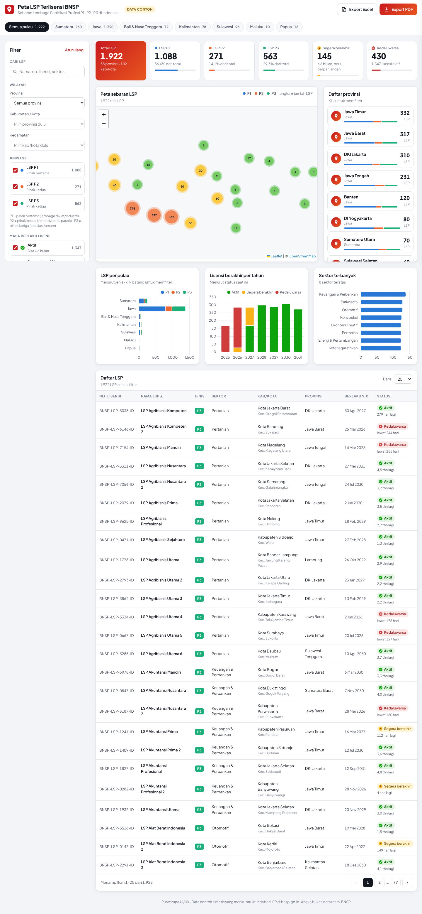

# Peta LSP BNSP — Purwarupa Dashboard

Purwarupa UI/UX untuk memetakan Lembaga Sertifikasi Profesi (LSP) P1, P2, dan P3 yang berlisensi BNSP.



Data diambil dari daftar LSP resmi di <https://bnsp.go.id/lsp> (2.700 LSP: aktif, kedaluwarsa, dan tidak aktif),
lengkap dengan jenis (P1/P2/P3), nomor lisensi, SK, masa berlaku, alamat, dan kontak dari halaman detail tiap LSP.

## Cara menjalankan

Tidak perlu build. Semua pustaka sudah disertakan di folder `vendor/`. Butuh PHP 7.4+ (untuk login).

```bash
BNSPMAP_CONFIG_DIR=/path/ke/config php -S 127.0.0.1:8000
```

Lalu buka <http://127.0.0.1:8000>.
Peta dasar (OpenStreetMap) dan font memerlukan koneksi internet.

## Login

Dashboard hanya bisa dibuka setelah masuk lewat `login.php` (sesi PHP). File data `js/lsp-data.js` diblokir dari akses langsung
dan hanya disajikan lewat `data.php` kepada pengguna yang sudah masuk.

- Akun disimpan di `../bnspmap-config/users.php` (di **luar** folder web), formatnya:
  ```php
  <?php
  return [
    'admin' => ['name' => 'Administrator', 'hash' => '$2y$10$...'],
  ];
  ```
  Nama pengguna ditulis huruf kecil. Hash dibuat dengan `php tools/hash-password.php`.
- Setelah 5 kali gagal dari alamat IP yang sama, login dikunci 15 menit.
- Sesi berakhir otomatis setelah 8 jam tidak aktif.
- Menjalankan lokal: `BNSPMAP_CONFIG_DIR=/path/ke/config php -S 127.0.0.1:8000` lalu buka <http://127.0.0.1:8000>.

## Fitur sesuai kebutuhan

| # | Kebutuhan | Implementasi |
|---|-----------|--------------|
| 1 | Tampilkan LSP di peta geografis | Peta Leaflet + OpenStreetMap, titik dikelompokkan (cluster) dengan angka jumlah LSP, warna titik menurut jenis (P1/P2/P3). Klik titik untuk popup dan detail. |
| 2 | Filter per pulau | Tab pulau di bawah header (Sumatera, Jawa, Bali & Nusa Tenggara, Kalimantan, Sulawesi, Maluku, Papua) lengkap dengan jumlah. Klik batang grafik "LSP per pulau" juga memfilter. |
| 3 | Filter provinsi, kabupaten/kota, kecamatan | Tiga dropdown bertingkat di panel filter. Klik kartu di "Daftar provinsi" juga memfilter. Peta otomatis zoom ke wilayah terpilih. |
| 4 | Filter P1, P2, P3 | Kotak centang jenis LSP, dengan jumlah per jenis. |
| 5 | Filter masa berlaku | Status lisensi (Aktif > 6 bulan, Segera berakhir ≤ 6 bulan, Kedaluwarsa), pintasan (≤ 3/6/12 bulan, tahun tertentu), dan rentang tanggal berakhir. Klik batang grafik "Lisensi berakhir per tahun" juga memfilter. |
| 6 | Dashboard + export XLS/PDF | KPI, peta, daftar provinsi, 3 grafik, tabel bisa diurutkan dan dipaginasi, panel detail LSP. **Export Excel** (.xlsx: sheet *Data LSP* + *Ringkasan*) dan **Export PDF** (A4 lanskap: ringkasan, grafik, rekap per provinsi, daftar LSP). Keduanya mengikuti filter yang aktif. |

Tambahan: pencarian nama/no. lisensi, filter sektor, chip filter aktif yang bisa dihapus satu per satu,
tampilan mobile (panel filter jadi laci), dan mode gelap mengikuti pengaturan sistem.

## Struktur

```
index.php         halaman dashboard (wajib login)
login.php         halaman masuk; logout.php keluar; auth.php logika sesi
data.php          menyajikan js/lsp-data.js hanya untuk pengguna yang sudah masuk
css/style.css     gaya (token warna terang/gelap, responsif)
js/lsp-data.js    data LSP hasil unduhan (dibuat otomatis)
js/app.js         filter, peta, grafik, tabel, export
crawl.php         halaman Pembaruan Data (crawl manual, jadwal, status, riwayat); crawl-api.php API-nya
lib/              mesin crawl (crawler.php, regions.php, crawl-state.php) + referensi wilayah (data/)
tools/            cron.php (pelaksana crawl dari cron), skrip Python lama, hash-password.php
vendor/           Leaflet 1.9.4, MarkerCluster 1.5.3, Chart.js 4.4.1, SheetJS 0.18.5, jsPDF 2.5.1, jsPDF-AutoTable 3.8.2
```

## Sumber data dan cara lokasi ditentukan

| Data | Sumber |
|------|--------|
| Nama, no. lisensi, SK, jenis, masa berlaku, status, alamat, kontak, jumlah skema | Halaman daftar & detail LSP di bnsp.go.id |
| Titik koordinat (sekitar 1.100 LSP) | Peta LSP di beranda bnsp.go.id (`/lsp-map`) |
| Provinsi, kab/kota, kecamatan | Dari titik koordinat (reverse geocoding OpenStreetMap Nominatim); bila tidak ada titik, dicocokkan dari teks alamat dengan referensi wilayah Kemendagri ([idn-area-data](https://www.npmjs.com/package/idn-area-data)) |
| Titik untuk LSP tanpa koordinat | Pusat kecamatan atau kab/kota hasil geocoding, ditandai "perkiraan" di panel detail |

Catatan:
- Status **Aktif / Segera berakhir (≤ 6 bulan) / Kedaluwarsa** dihitung dari tanggal masa berlaku terhadap hari ini. Status asli di BNSP tetap ditampilkan di panel detail dan ikut diekspor.
- Sebagian alamat di BNSP tidak lengkap, sehingga beberapa LSP masuk kelompok "Lokasi belum diketahui".
- Beberapa halaman detail di bnsp.go.id tidak bisa dibuka (404). Untuk LSP tersebut, jenis LSP diperkirakan dari namanya dan diberi tanda "perkiraan".

## Memperbarui data (crawl)

bnsp.go.id tidak punya API, jadi data diambil ulang dengan membaca halaman daftar & detail LSP (crawl).
Admin membuka **Update data** di dashboard (`crawl.php`) lalu memilih cakupan:

| Cakupan | Yang diambil ulang |
|---------|--------------------|
| Nasional | Detail semua LSP (±2.700, ±20 menit) |
| Per provinsi | Detail LSP di provinsi tersebut |
| Sampai kabupaten/kota | Detail LSP di kab/kota tersebut |

Pada semua cakupan, seluruh halaman daftar LSP (±130 halaman, ±1 menit) tetap dibaca untuk menemukan **LSP baru**
(selalu ditambahkan) dan LSP yang **sudah tidak ada** di BNSP (dihapus hanya bila berada dalam cakupan dan daftar terbaca lengkap).
Wilayah LSP yang alamat & titiknya tidak berubah dipakai ulang, sehingga geocoding hanya untuk LSP baru/berubah.

Cara kerja di server:
- Tombol **Mulai crawl** dan **jadwal otomatis** (harian/mingguan/bulanan, WIB) memasukkan pekerjaan ke antrean.
- Cron hosting menjalankan `tools/cron.php` setiap 5 menit; skrip ini menjalankan jadwal yang jatuh tempo dan mengerjakan antrean
  (satu per satu, dikunci dengan `flock`). Crawl berjalan sebagai proses PHP CLI, jadi tidak terkena batas waktu web.
- Cron yang dipakai:
  ```
  */5 * * * * /opt/alt/php83/usr/bin/php /home/semestat/bnspmap.semestateknologiutama.com/tools/cron.php >> /home/semestat/bnspmap-config/crawler/cron.log 2>&1
  ```
- Status, antrean, jadwal, riwayat, log, cache geocoding, dan **data hasil crawl** disimpan di `../bnspmap-config/crawler/`
  (di luar folder web, tidak tertimpa saat deploy). Versi data sebelumnya disimpan sebagai `data/lsp-data.prev.js`.
  Bila belum pernah crawl, dashboard memakai `js/lsp-data.js` bawaan repo.
- Crawl manual dari server: `php tools/cron.php --now nasional`, `--now "provinsi:Jawa Timur"`, atau
  `--now "kabkota:Jawa Timur:Kabupaten Tuban"`.

Mesin crawl ada di `lib/crawler.php` + `lib/regions.php` (PHP, setara dengan skrip Python lama di `tools/*.py`).
Referensi wilayah `lib/data/*.csv` berasal dari [idn-area-data](https://github.com/fityannugroho/idn-area-data)
(lisensi ODbL, lihat `lib/data/LICENSE-idn-area-data.md`). Geocoding memakai Nominatim OpenStreetMap
(© kontributor OpenStreetMap, maks. 1 permintaan/detik).

## Format data

`js/lsp-data.js` berisi `window.LSP_META` dan `window.LSP_DATA`, yaitu array objek seperti:

```js
{
  id: 1, slug: "lsp-smk-pelayaran-kristen-tuban",   // slug = alamat halaman detail di bnsp.go.id/lsp/<slug>
  nama: "LSP SMK Pelayaran Kristen Tuban",
  jenis: "P1", jenisPerkiraan: false,
  noLisensi: "BNSP-LSP-1305-ID", sk: "KEP.2482/BNSP/XI/2021",
  tglBerakhir: "2026-11-29", statusResmi: "Aktif",
  alamat: "...", telepon: "...", email: "...", web: "...", jmlSkema: 1,
  pulau: "Jawa", provinsi: "Jawa Timur", kabkota: "Kabupaten Tuban", kecamatan: "...",
  lat: -6.9, lng: 112.05,
  akurasi: "titik"   // titik | kecamatan | kabkota | provinsi | tidak ada
}
```
